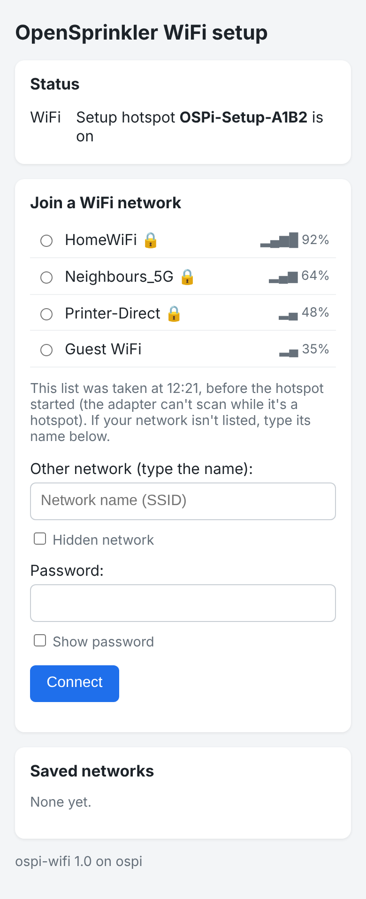
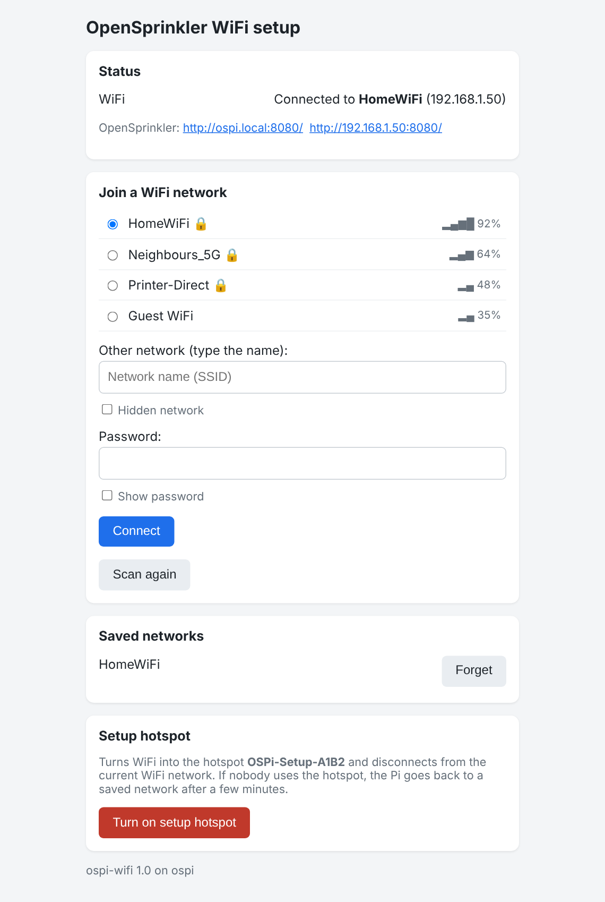
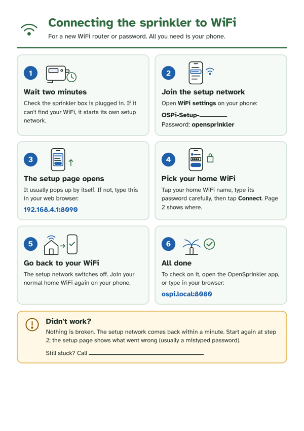
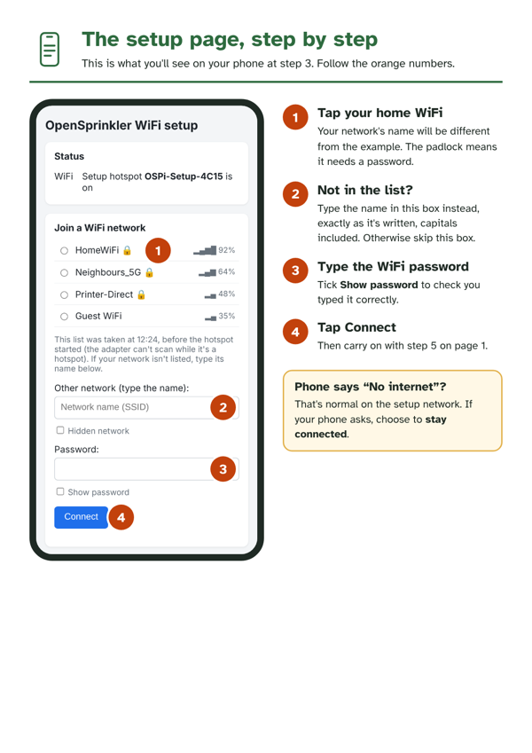

# ospi-wifi

WiFi fallback hotspot and setup console for OpenSprinkler Pi (OSPi).

- If the Pi can't join a saved WiFi network, it starts a setup hotspot. By default the hotspot is called `OSPi-Setup-XXXX` and its password is `opensprinkler`.
- A web console on port **8090** lets anyone pick a WiFi network and enter its password. They don't need a keyboard, SSH or Linux knowledge.
- On the hotspot, phones usually pop up the setup page by themselves (captive portal). If not, browse to `http://192.168.4.1:8090/`.
- On the home network, `http://<pi>:8090/` opens the same console, and plain `http://<pi>/` redirects to OpenSprinkler on port 8080.

| On the setup hotspot (phone) | On the home network |
|---|---|
|  |  |

Network names in these screenshots are examples.

It's a single Python 3 script with no dependencies beyond the standard library. It drives NetworkManager through `nmcli`, so it needs Raspberry Pi OS **Bookworm or later**.

## Printable guide for non-technical users

[`docs/ospi-wifi-setup-guide.pdf`](docs/ospi-wifi-setup-guide.pdf) is a two-page A4 picture guide to setting up the WiFi from a phone. Print it and keep it with the controller. Write the end of your hotspot name in the blank on page 1. It's in the log line `Hotspot OSPi-Setup-XXXX is on`, or set a fixed name with `HOTSPOT_SSID`.

| Page 1: the steps | Page 2: the setup page |
|---|---|
|  |  |

## Install

Copy the folder to the Pi, then:

```
cd ospi-wifi
sudo ./install.sh
```

Before installing, edit `ospi-wifi.conf` if you want a different hotspot name, password, country or console password. After installing, the settings are in `/etc/ospi-wifi.conf`. Run `sudo systemctl restart ospi-wifi` after any change.

Check the WiFi adapter can act as a hotspot. Look for `* AP` in the output of:

```
iw list | grep -A 10 "Supported interface modes"
```

The installer warns if it can't find AP mode.

## What a novice does

1. Power up the OpenSprinkler somewhere it can't reach a known network. After about 90 seconds, the `OSPi-Setup-XXXX` network appears.
2. Join it on a phone (password `opensprinkler`). The setup page should open by itself. If it doesn't, browse to `http://192.168.4.1:8090/`.
3. Pick the home network, type its password, and tap **Connect**.
4. The hotspot turns off. Reconnect the phone to the home network and open `http://<hostname>.local:8080/`, or find the Pi in the router's device list.
5. If the password was wrong, the hotspot comes back within about a minute, and the setup page shows the error.

## How it behaves

| Situation | What happens |
|---|---|
| Boot, saved network in range | NetworkManager joins it as normal. Nothing else happens. |
| No connection 90 s after boot | Tries each saved network in range, strongest first. If none works, starts the hotspot. |
| Connection drops for 60 s | Same as above. |
| Hotspot on, nobody using it | Every 5 minutes, it briefly turns the hotspot off to look for saved networks (about 30–60 s), then turns it back on if none answer. This covers the router booting more slowly than the Pi after a power cut. |
| Hotspot on, a phone connected or the console used in the last 5 minutes | It stays on the hotspot. |
| "Turn on setup hotspot" pressed in the console | Switches to the hotspot now. It returns to a saved network once the hotspot has been idle for 5 minutes. |

To keep the Pi on the hotspot permanently (for a site with no router), set `RETRY_INTERVAL=0`.

OpenSprinkler keeps running and watering throughout. The hotspot is only for getting the Pi back onto WiFi: OpenSprinkler's own web page loads its interface from the internet, so it may not open in a browser while the hotspot is on. Without internet there's also no weather data or time sync, and the Pi has no clock battery, so it relies on the last saved time.

## Notes and limits

- **The network list on the hotspot is a snapshot.** A single WiFi adapter can't scan while it's acting as a hotspot, so the console shows the networks it saw just before the hotspot started. You can type any network name by hand.
- The hotspot is 2.4 GHz WPA2 on channel 6. Change `HOTSPOT_CHANNEL` if that channel is busy.
- WPA2/WPA3 personal and open networks are supported. Enterprise (802.1X) networks aren't.
- **Captive portal.** While the hotspot is on, NetworkManager's built-in dnsmasq answers every DNS name with the Pi, using `/etc/NetworkManager/dnsmasq-shared.d/ospi-wifi-portal.conf`. This doesn't affect the home network. Set `PORTAL_PORT=0` to turn the captive portal off.
- **Console password.** `CONSOLE_PASSWORD` protects the console when it's opened from the home network. On the hotspot, the WPA2 password is the protection.
- Connecting to a network you already saved replaces the old entry, but only after the new password works. A typo won't lose a working network.
- Don't run the full `dnsmasq` service as well. It clashes with the hotspot's DHCP.

## Troubleshooting

```
journalctl -u ospi-wifi -f            # live log (set DEBUG=yes for nmcli detail)
nmcli device status                   # what wlan0 is doing
nmcli connection show                 # saved profiles (the hotspot is OSPi-Hotspot)
sudo nmcli connection up OSPi-Hotspot # force the hotspot on by hand
```

If the log says `wlan0 isn't present yet`, Linux can't see the WiFi adapter. Check `lsusb`, `ip link` and `dmesg`. On a Pi 1, a USB WiFi dongle can draw more power at boot than the port supplies; a powered USB hub fixes that. The setup console stays reachable over Ethernet while it waits, and the hotspot starts once the adapter appears.

If the hotspot won't start, the log shows NetworkManager's error. Usually the adapter or driver doesn't support AP mode, or WiFi is blocked because no country is set (`rfkill list`).

## Uninstall

```
sudo systemctl disable --now ospi-wifi
sudo nmcli connection delete OSPi-Hotspot
sudo rm -rf /opt/ospi-wifi /var/lib/ospi-wifi /etc/ospi-wifi.conf \
  /etc/systemd/system/ospi-wifi.service \
  /etc/NetworkManager/dnsmasq-shared.d/ospi-wifi-portal.conf
sudo systemctl daemon-reload
```
